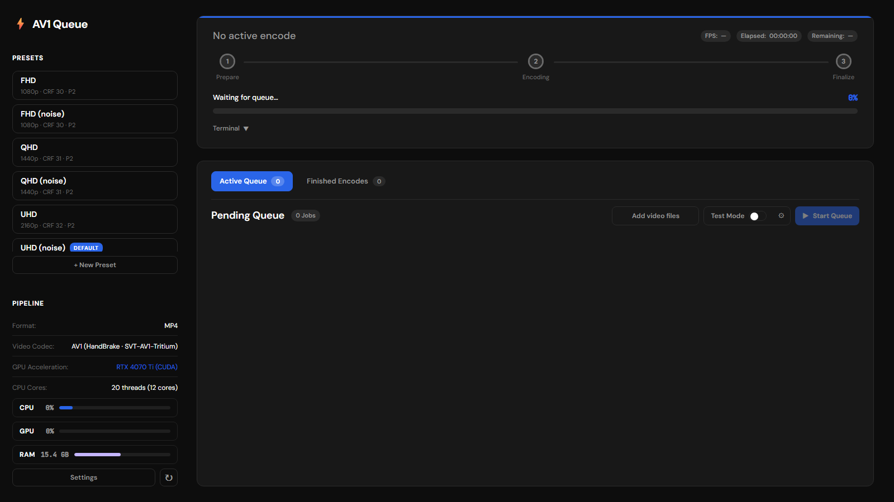

<p align="center">
  
</p>

# AV1 Queue

A local Windows AV1 encoding queue with a browser UI, for preparing a Jellyfin library that direct-plays.



## Features

- Queue movies and shows from the built-in file browser or a watch folder, then reorder, edit, pause, and retry jobs.
- Pause the queue automatically while you use the PC and resume it when the PC is locked or other apps go quiet.
- Encode to AV1 in a single pass with [HandBrakeCLI built with SVT-AV1-Tritium](https://github.com/Uranite/HandBrake-SVT-AV1-Tritium), using shareable presets, to MP4 or WebM.
- Keep HDR10, HLG, HDR10+, and Dolby Vision where the source allows it. Sources that can't be encoded safely are skipped or quarantined, never damaged.
- Choose audio and subtitle tracks per job, with Opus or E-AC-3 audio and text subtitle sidecars.
- Fill in missing subtitles from OpenSubtitles, retimed automatically to the movie's audio.
- Try a preset on a short segment with Test Mode to see its estimated full size and encode time, plus an optional SSIMU2 score.
- Watch live progress, logs, and CPU, GPU, and RAM gauges from your browser.

## Usage

Requires Windows x64 and Python 3.12-3.15 (3.13 recommended). An NVIDIA GPU is optional, for faster SSIMU2 scoring.

```powershell
.\setup.bat
.\runGUI.bat
```

The server runs in the background with a tray icon, and opens <http://localhost:8765> on first launch.

To encode a movie, add it through the file browser, pick a preset, and start the queue. The output lands next to the source unless you set an output folder in Settings.

Settings are in [Configuration](docs/CONFIGURATION.md).

## Development

There are no automated tests. To run the server in the foreground with live logs:

```powershell
.\scripts\start_queue.ps1
```

The UI has no build step: edit `server/static/*` and refresh the browser. Agents working on the project also follow [AGENTS.md](AGENTS.md).

## Docs

- [Architecture](docs/ARCHITECTURE.md): how it works, the encode stages, and the format and HDR rules
- [Configuration](docs/CONFIGURATION.md): launcher settings, network access, naming, and presets
